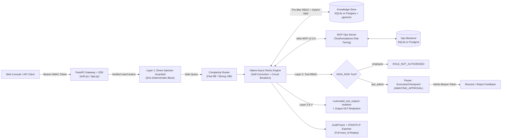
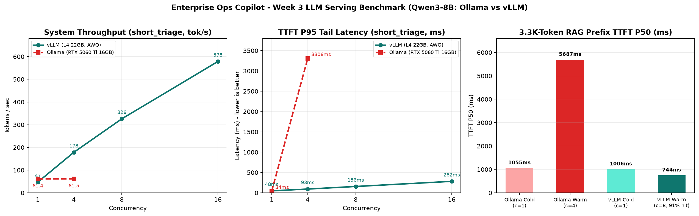

# Enterprise Ops Copilot

> **Production-grade Internal IT & SRE Operations Agent built from first principles** — featuring **ACL-First Hybrid RAG**, **MCP Human-in-the-Loop (HITL)**, **4-Layer Security Guardrails**, **HMAC Bearer API Auth**, **OpenTelemetry / OTLP Span Export**, **Complexity Model Routing**, and **SQLite / PostgreSQL (`pgvector`) Dual Storage Backends**.

[](https://github.com/vincent-314/enterprise-ops-copilot/actions/workflows/ci.yml)
[](https://www.python.org/downloads/)
[](LICENSE)

[English](README.md) | [简体中文](README.zh-CN.md)

---

## Why This Project Exists

Most LLM agent demos fail in production because they treat security, observability, and cost as afterthoughts:
- **Prompt-only ACLs leak secrets** under prompt injection.
- **Black-box orchestration frameworks** hide context pruning, malformed tool-call recovery, and loop circuit breakers.
- **Unbounded high-risk tool execution** lets models restart or roll back production services without human approval.
- **HTTP layers trust client-asserted roles** (`{"role": "ops_admin"}`), undoing backend RBAC.

**Enterprise Ops Copilot** solves each of these in clean, inspectable Python (`~300` lines for the core ReAct loop) with zero framework lock-in, full offline deterministic testability, and seamless switching between **local open-source models (Ollama / vLLM)** and **OpenAI cloud models**.

---

## End-to-End Architecture



---

## Core Engineering Highlights

| Capability | Implementation | Why It Matters |
| :--- | :--- | :--- |
| **API Gateway Auth Boundary** | Stateless HMAC-SHA256 Bearer tokens (`api/auth.py`), server-derived `UserContext`, `403` on non-admin `/api/approvals/*` & cross-user `/api/traces/*` | Never trusts client JSON body or LLM arguments for caller identity |
| **ACL-First Hybrid RAG** | Markdown heading-aware chunking, SQL pre-filter by `allowed_roles`, dense vectors + CJK/ASCII BM25 + RRF fusion (`rag/store.py`) | Classified SRE runbooks never enter scoring or LLM context for unauthorized roles |
| **Native ReAct Runtime** | Explicit async loop (`runtime/engine.py`), Pydantic validation self-correction, `max_steps` / token budget / duplicate-call circuit breakers, atomic tool-group pruning | Predictable failure recovery without black-box framework abstractions |
| **MCP + HITL Governance** | Official `mcp==2.3.0` stdio server (`mcp_bridge/ops_server.py`), `ToolAnnotations` → `READ`/`WRITE_LOW`/`HIGH_RISK`, persistent `ExecutionCheckpoint` pause & resume | High-risk mutations (`restart_service`, `rollback_deployment`) pause cleanly; human rejections feed back to the model |
| **4-Layer Defense-in-Depth** | Direct injection block before router (`0.0 ms`), code-level tool RBAC, `<untrusted_tool_output>` indirect-injection tagging, output DLP redaction (`security/guardrails.py`) | Stops both direct jailbreaks and poisoned ticket payloads |
| **Dual Storage Backends** | Zero-config **SQLite** default + **PostgreSQL + `pgvector`** cloud profile (`storage/postgres.py`, `docker-compose.yml --profile postgres`) | Runs locally in 5 seconds; scales horizontally in Docker/Kubernetes |
| **Observability & Evals** | Chronological SQLite/Postgres `AuditTracer`, OTLP/JSONL span export (`observability/otel.py`), 10-case golden suite + LLM-as-a-Judge (`evals/`) | Every run is replayable by `trace_id` and regression-tested |

---

## Evaluation Benchmarks (10-Case Golden Suite)

Measured across 10 enterprise scenarios (RAG QA, ACL isolation, multi-hop root-cause triage, HITL rollback gating, direct jailbreak, poisoned ticket indirect injection, ambiguous restraint, and ticket creation) using local `qwen3:8b`, `qwen3:14b`, and `ComplexityRouter`, graded by deterministic assertions + `qwen3:14b` LLM-as-a-Judge:

| Strategy | Det Pass | Overall Pass | Pass Rate | Avg Faithfulness | P50 Latency | Total Tokens |
| :--- | :---: | :---: | :---: | :---: | :---: | :---: |
| `fixed:qwen3:8b` | 7/10 | 7/10 | 70.0% | 4.80 / 5 | 10,925 ms | 28,799 |
| `fixed:qwen3:14b` | 7/10 | 7/10 | 70.0% | 4.80 / 5 | 21,344 ms | 26,328 |
| `router:8b+14b` (v1) | 9/10 | 8/10 | 80.0% | 4.71 / 5 | 19,929 ms | 26,230 |
| `router:8b+14b` (v2, guardrail-first) | 9/10 | 9/10 | 90.0% | 4.86 / 5 | 18,400 ms | 29,841 |
| **`router:8b+14b` (v3, EN + sequential triage)** | **10/10** | **10/10** | **100.0%** | **5.00 / 5** | **19,155 ms** | **35,728** |

- Moving deterministic input guardrails **before** the LLM router cut direct jailbreak latency from `10,013 ms` down to **`0.0 ms` (`0 tokens`)**.
- Enforcing sequential discovery (`list_incidents` before `get_service_metrics`/`search_recent_deployments`) + `4096` max tokens eliminated speculative `SERVICE_NOT_FOUND` tool calls, cutting `ops_multihop_root_cause` latency from `110,263 ms` to **`49,898 ms`** and pushing the suite to **10/10 (100.0%)**.
- Full per-case breakdowns and judge critiques: [v1 Baseline Report](docs/benchmarks/phase5_eval_report.md) · [v2 Router Report](docs/benchmarks/phase5_eval_v2_router.md) · [v3 10/10 EN Report](docs/benchmarks/phase5_eval_v3_router_en.md).

---

## Production LLM Serving Benchmark (Ollama vs. vLLM)

Benchmarked `Qwen3-8B` across local single-node **Ollama (`RTX 5060 Ti 16GB`)** and cloud **vLLM (`NVIDIA L4 22GB`, `Qwen/Qwen3-8B-AWQ`, `--enable-prefix-caching --tool-call-parser hermes`)** using [scripts/bench_serving.py](scripts/bench_serving.py) and [week3_vllm_sglang_colab.ipynb](benchmarks/week3_vllm_sglang_colab.ipynb):



- **Continuous Batching Scaling (`short_triage`, strict JSON Schema):** Local Ollama stalled at `61.5 tok/s` (`TTFT P95 = 3,305.6 ms` at `c=4`), whereas **vLLM scaled 12.28x to `578.4 tok/s` (`10.66 RPS`) at `c=16`** with **`282.5 ms` `TTFT P95`** and **`100.0%` schema validity**.
- **Automatic Prefix Caching (`prefix_cache_rag`, ~3.3K prompt tokens):** Prometheus recorded a **`90.98%` prefix-cache hit rate** (`48,000 / 52,758`), driving `743.5 ms` `TTFT P50` at `c=8` (**7.6x faster** than Ollama warm `c=4` at `5,686.9 ms`).
- **Concurrent Tool-Calling (`tool_call_burst`, `c=16`):** **`501.3 tok/s` (`15.43 RPS`)**, **`100.0%` valid tool-call arguments**, and **`4/4 PASS`** on `scripts/probe_models.py`.
- Full data, Prometheus deltas, and deployment takeaways: **[English Serving Benchmark Report](docs/LLM_SERVING_BENCHMARK.md)** · **[中文压测报告](docs/LLM_SERVING_BENCHMARK.zh-CN.md)**.

---

## Quickstart

### 1. Local Setup & Offline Test Suite (Zero External Services Needed)

```bash
uv sync
uv run ruff check .
uv run pytest -v
```

### 2. Run with Local Ollama (`qwen3:8b` / `qwen3:14b` + `bge-m3`)

```bash
cp .env.example .env
# Ensure Ollama is running with OLLAMA_CONTEXT_LENGTH=16384
uv run python scripts/ingest_knowledge.py
uv run python scripts/run_server.py
# Open http://127.0.0.1:8000 (supports EN / 中文 UI switch + one-click persona tokens)
```

### 3. Run with Docker Compose

**Zero-config SQLite mode:**
```bash
docker compose up --build
# Console available at http://127.0.0.1:8000
```

**Cloud-native PostgreSQL + `pgvector` mode:**
```bash
docker compose --profile postgres up --build
# Console available at http://127.0.0.1:8001 backed by pgvector/pgvector:pg16
```

### 4. Switch to OpenAI Cloud API

Copy `.env.openai.example` to `.env`, plug in your `OPENAI_API_KEY`, and set `ALLOW_DEMO_TOKENS=false` in production:

```bash
cp .env.openai.example .env
```

---

## API & Auth Quick Example

```bash
# 1. Obtain a signed Bearer token (demo mode)
TOKEN=$(curl -s -X POST http://127.0.0.1:8000/api/auth/demo-token \
  -H "Content-Type: application/json" \
  -d '{"user_id":"bob","role":"ops_admin","department":"sre_ops"}' | python -c "import sys,json; print(json.load(sys.stdin)['access_token'])")

# 2. Stream agent triage & HITL checkpoint pause via SSE
curl -N -X POST http://127.0.0.1:8000/api/chat/stream \
  -H "Authorization: Bearer $TOKEN" \
  -H "Content-Type: application/json" \
  -d '{"query":"Check open P1 incidents and order-api deployments; roll back if caused by the latest release."}'
```

---

## Repository Structure

- `src/enterprise_ops_agent/api/` — FastAPI app, HMAC Bearer auth, SSE streaming service, bilingual Web Console (`static/index.html`)
- `src/enterprise_ops_agent/runtime/` — Native ReAct `AgentEngine`, atomic context pruning, `CheckpointStore`, `ComplexityRouter`
- `src/enterprise_ops_agent/rag/` — Markdown heading chunker, SQLite ACL-first Hybrid RAG (`bge-m3` + CJK BM25 + RRF)
- `src/enterprise_ops_agent/mcp_bridge/` — Official `mcp` stdio Ops Server & client bridge with `ToolAnnotations` risk mapping
- `src/enterprise_ops_agent/security/` — 4-layer deterministic `GuardrailPolicy` (injection block, tool RBAC, `<untrusted_tool_output>`, DLP)
- `src/enterprise_ops_agent/observability/` — `AuditTracer`, timeline formatter, OTel/OTLP JSONL & HTTP span exporter
- `src/enterprise_ops_agent/storage/` — Dual backend factory & `PostgreSQL + pgvector` implementations
- `src/enterprise_ops_agent/evals/` — Bilingual 10-case golden dataset, deterministic + LLM-as-a-Judge grader, benchmark runner
- `docs/ARCHITECTURE_AND_ADR.md` — Detailed Architecture Decision Records (ADR-001 to ADR-007) & field pitfalls

---

## License

[MIT](LICENSE)
