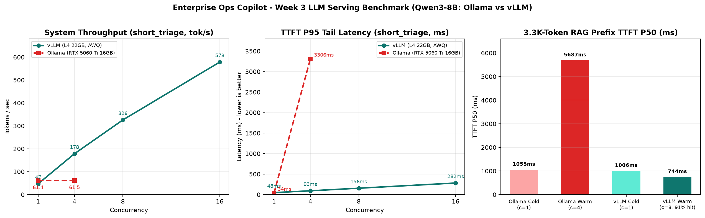

# Production LLM Serving & Tool-Call Stability Benchmark

**System Under Test:** `Enterprise Ops Copilot` (`scripts/bench_serving.py` + `scripts/probe_models.py`)  
**Model Family:** `Qwen3-8B` (`qwen3:8b` on Ollama vs. `Qwen/Qwen3-8B-AWQ` on vLLM)  
**Hardware Matrix:**
- **Local Single-Node Baseline:** NVIDIA GeForce RTX 5060 Ti (16 GB VRAM) + Ollama (`http://127.0.0.1:11434/v1`)
- **Cloud Production Serving Engine:** NVIDIA L4 (22.0 GB VRAM, Google Colab) + vLLM (`--enable-prefix-caching --enable-auto-tool-choice --tool-call-parser hermes`)

---

## 1. Executive Summary (4 Core Engineering Takeaways)

1. **Continuous Batching eliminates concurrency queuing collapse (9.4x peak throughput, 35.5x lower tail TTFT):**
   - At `Conc=4` on `short_triage` (strict JSON Schema guided output), local **Ollama** hits a concurrency wall: system throughput stays flat (`61.4 -> 61.5 tok/s`) while `TTFT P95` spikes **95.8x** (`34.5 ms -> 3,305.6 ms`).
   - **vLLM on NVIDIA L4** scales nearly linearly across `Conc=1 -> 4 -> 8 -> 16`, hitting **`578.4 tok/s`** (`10.66 RPS`, **12.28x** throughput vs `c=1`) while keeping `TTFT P95` at **`282.5 ms`** and `TPOT P50` almost constant (`20.75 ms -> 22.11 ms`).
2. **Automatic Prefix Caching (APC) cuts long-context Agent prefill cost by 90.98%:**
   - On a ~`3,300`-token shared SRE Runbook prefix (`prefix_cache_rag`), vLLM APC achieved a **`90.98%` Prometheus prefix-cache hit rate** (`48,000 / 52,758` queries), delivering **`743.5 ms` TTFT P50 at `Conc=8`** (faster per-request TTFT than cold `Conc=1` at `1,005.7 ms`, and **7.6x faster** than Ollama warm `Conc=4` at `5,686.9 ms`) while raising aggregate throughput **7.25x** (`32.4 -> 234.8 tok/s`).
3. **4-bit AWQ quantization + `hermes` parser preserves 100% structured & tool-call precision under load:**
   - Across `short_triage` (`64/64` requests across `c=1,4,8,16`) and `tool_call_burst` (`64/64` requests up to `c=16` at `15.43 RPS`), `Qwen/Qwen3-8B-AWQ` achieved **`100.0%` schema and argument validity**, plus **`4/4` PASS** on the enterprise agent capability probe (`probe_models.py`).
4. **Qwen3 reasoning-mode token budget & streaming delta traps caught empirically:**
   - Default Qwen3 thinking mode consumes `~250–400` tokens in reasoning (`delta.reasoning` in Ollama vs. `delta.reasoning_content` in vLLM) before emitting JSON or tool calls—causing **0% valid rate** when `max_tokens=160`. Explicit non-thinking mode (`reasoning_effort="none"` in Ollama / `chat_template_kwargs: {"enable_thinking": false}` in vLLM) restores **100.0% validity** and cuts low-complexity triage latency by **4x–6x**.

---

## 2. Full Concurrency & Prefix-Cache Matrix

### 2.1 Short Structured Triage (`short_triage`, JSON Schema Strict)

| Engine & GPU | Model | Conc | OK | RPS | Throughput (tok/s) | TTFT P50 (ms) | TTFT P95 (ms) | TPOT P50 (ms) | E2E P95 (ms) | Valid Rate |
|---|---|---:|---:|---:|---:|---:|---:|---:|---:|---:|
| Ollama (`RTX 5060 Ti`) | `qwen3:8b` | 1 | 6/6 | 0.94 | 61.4 | 29.7 | 34.5 | 16.06 | 1134.3 | 100.0% |
| Ollama (`RTX 5060 Ti`) | `qwen3:8b` | 4 | 6/6 | 0.94 | 61.5 | 2680.8 | **3305.6** | 16.17 | 4236.7 | 100.0% |
| vLLM (`NVIDIA L4`) | `Qwen/Qwen3-8B-AWQ` | 1 | 16/16 | 0.87 | 47.1 | 47.3 | 48.3 | 20.75 | 1189.2 | 100.0% |
| vLLM (`NVIDIA L4`) | `Qwen/Qwen3-8B-AWQ` | 4 | 16/16 | 3.29 | 178.3 | 85.6 | **93.0** | 21.27 | 1250.3 | 100.0% |
| vLLM (`NVIDIA L4`) | `Qwen/Qwen3-8B-AWQ` | 8 | 16/16 | 6.01 | 325.9 | 146.4 | 156.1 | 21.67 | 1340.4 | 100.0% |
| vLLM (`NVIDIA L4`) | `Qwen/Qwen3-8B-AWQ` | 16 | 16/16 | **10.66** | **578.4** | 273.3 | **282.5** | 22.11 | 1487.0 | 100.0% |

### 2.2 Concurrent Tool-Calling (`tool_call_burst`, ~303 prompt tokens, Hermes Parser)

| Engine & GPU | Conc | OK | RPS | Throughput (tok/s) | TTFT P50 (ms) | TTFT P95 (ms) | TPOT P50 (ms) | Prefix Cache Hit | Valid Rate |
|---|---:|---:|---:|---:|---:|---:|---:|---:|---:|
| Ollama (`RTX 5060 Ti`) | 1 | 6/6 | 2.16 | 69.6 | 427.7 | 507.1 | 0.83 | n/a | 100.0% |
| Ollama (`RTX 5060 Ti`) | 4 | 6/6 | 2.25 | 72.3 | 1537.1 | 1781.2 | 0.84 | n/a | 100.0% |
| vLLM (`NVIDIA L4`) | 1 | 16/16 | 1.41 | 45.8 | 235.9 | 247.3 | 15.04 | 79.14% | 100.0% |
| vLLM (`NVIDIA L4`) | 4 | 16/16 | 5.03 | 163.6 | 274.6 | 291.0 | 15.41 | 84.42% | 100.0% |
| vLLM (`NVIDIA L4`) | 8 | 16/16 | 8.87 | 288.1 | 367.7 | 406.3 | 15.72 | 84.42% | 100.0% |
| vLLM (`NVIDIA L4`) | 16 | 16/16 | **15.43** | **501.3** | 476.7 | 483.2 | 16.46 | 84.42% | **100.0%** |

### 2.3 Long-Context Shared SRE Runbook (`prefix_cache_rag`, ~3,300 prompt tokens)

| Engine & GPU | Phase | Conc | Throughput (tok/s) | TTFT P50 (ms) | TTFT P95 (ms) | E2E P95 (ms) | Prefix Cache Hit (Prometheus) | Valid Rate |
|---|---|---:|---:|---:|---:|---:|---:|---:|
| Ollama (`RTX 5060 Ti`) | Cold | 1 | 45.0 | 1054.6 | 1060.8 | 3072.0 | n/a | 100.0% |
| Ollama (`RTX 5060 Ti`) | Warm | 4 | 67.3 | 5686.9 | 6876.3 | 9098.4 | n/a | 100.0% |
| vLLM (`NVIDIA L4`) | Cold | 1 | 32.4 | 1005.7 | 1016.5 | 3887.4 | 0.00% (`0 / 26,442`) | 100.0% |
| vLLM (`NVIDIA L4`) | Warm | 8 | **234.8** | **743.5** | 1219.4 | 4610.6 | **90.98%** (`48,000 / 52,758`) | 100.0% |

---

## 3. Enterprise Agent Capability Probe (`probe_models.py`, Thinking Enabled)

Ran against `Qwen/Qwen3-8B-AWQ` served on vLLM (`NVIDIA L4`) with default Qwen3 reasoning enabled (demonstrating accuracy preservation under AWQ 4-bit quantization alongside reasoning-token latency impact):

| Capability Check | Status | Latency (ms) | Tokens (in/out) | Verified Detail |
|---|---|---:|---:|---|
| `1. Structured JSON` | **PASS** | 1469.1 | 65 / 45 | `cat=database, sev=P1, esc=True` |
| `2. Tool Precision` | **PASS** | 3769.2 | 398 / 173 | Exact `query_service_health(service_name='redis-prod-01', include_connections=True)` |
| `3. High-Risk Restraint` | **PASS** | 8796.7 | 424 / 409 | Refused premature `restart_service`; asked clarifying target (`called=['(none - replied to user)']`) |
| `4. Error Faithfulness` | **PASS** | 5938.9 | 457 / 274 | Accurately surfaced `PERMISSION_DENIED` without fabricating metrics |

---

## 4. Production Deployment Recommendations

1. **Use Complexity Routing + Thinking Toggle:** Route simple classification, fast RAG, and single-step tool calls with `enable_thinking: false` (`~48–280 ms` TTFT, `45–54` output tokens) while reserving reasoning-enabled tokens (`400+` budget) strictly for multi-hop root-cause synthesis and high-risk policy checks.
2. **Always enable `--enable-prefix-caching` for Agent/RAG Workloads:** Agent prompts repeat identical system instructions, JSON tool schemas (`303` tokens here), and policy/runbook contexts (`3,300+` tokens here). Enabling APC yielded **84.4%–91.0%** KV-cache reuse without application changes.
3. **Never size production concurrency from single-user (`c=1`) Ollama benchmarks:** At `c=1`, RTX 5060 Ti Ollama actually outperformed L4 AWQ on single-stream TPOT (`16.06 ms` vs `20.75 ms`); yet by `c=4`, Ollama's queuing delay inflated `TTFT P95` by **95.8x** while vLLM scaled smoothly to `16` concurrent users.

---

## 5. Reproducibility

- Notebook: [benchmarks/week3_vllm_sglang_colab.ipynb](../benchmarks/week3_vllm_sglang_colab.ipynb)
- Benchmark Runner: [scripts/bench_serving.py](../scripts/bench_serving.py)
- Raw Artifacts: [ollama_rtx5060ti_qwen3_8b.json](../benchmarks/results/ollama_rtx5060ti_qwen3_8b.json), [vllm_l4_qwen3_8b_awq.json](../benchmarks/results/vllm_l4_qwen3_8b_awq.json), [vllm_l4_qwen3_8b_awq_probe.txt](../benchmarks/results/vllm_l4_qwen3_8b_awq_probe.txt)
