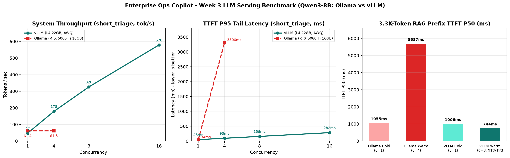

# 开源模型生产部署与 Tool-Call 稳定性基准报告（第 3 周实测）

**测试对象**：`Enterprise Ops Copilot`（[bench_serving.py](../scripts/bench_serving.py) + [probe_models.py](../scripts/probe_models.py)）  
**模型家族**：`Qwen3-8B`（本地 Ollama `qwen3:8b` vs 云端 vLLM `Qwen/Qwen3-8B-AWQ`）  
**硬件矩阵**：
- **本地单节点基线**：NVIDIA GeForce RTX 5060 Ti（16 GB 显存）+ Ollama（`http://127.0.0.1:11434/v1`）
- **云端生产推理引擎**：NVIDIA L4（22.0 GB 显存，Google Colab）+ vLLM（`--enable-prefix-caching --enable-auto-tool-choice --tool-call-parser hermes`）

---

## 一、核心工程结论（4 条可落地的架构判断）

1. **Continuous Batching 解决并发排队雪崩（吞吐提升 9.4 倍、P95 首字延迟快 35.5 倍）**：
   - 在 `short_triage`（JSON Schema 强约束）测试中，本地 **Ollama** 从并发 `1 -> 4` 时系统吞吐几乎停滞（`61.4 -> 61.5 tok/s`），但 `TTFT P95` 暴涨 **95.8 倍**（`34.5 ms -> 3,305.6 ms`）。
   - **Colab L4 上的 vLLM** 在并发 `1 -> 4 -> 8 -> 16` 下近乎线性扩展，16 并发系统吞吐达到 **`578.4 tok/s`**（`10.66 RPS`，相对单并发扩展 **12.28 倍**），同时 `TTFT P95` 稳定在 **`282.5 ms`**，每 Token 生成间隔 `TPOT P50` 仅从 `20.75 ms` 微增至 `22.11 ms`。
2. **Automatic Prefix Caching（APC）将长上下文 Agent 预填充复用率拉到 90.98%**：
   - 在 ~`3,300` tokens 共享运维 Runbook 的 `prefix_cache_rag` 场景下，vLLM Prometheus 实测前缓存命中率达 **`90.98%`**（`48,000 / 52,758` queries）。在 **8 并发** 下，Warm Prefix 的 `TTFT P50` 仅为 **`743.5 ms`**——不仅优于自身冷启动 `Conc=1`（`1,005.7 ms`），更比 Ollama Warm `Conc=4`（`5,686.9 ms`）快 **7.6 倍**，整体吞吐提升 **7.25 倍**（`32.4 -> 234.8 tok/s`）。
3. **AWQ 4-bit 量化 + `hermes` 解析器在高并发下保持 100% 结构化与工具调用准确率**：
   - 在 `short_triage`（`64/64`）与 `tool_call_burst`（`64/64`，最高 `16` 并发、`15.43 RPS`、`501.3 tok/s`）中，`Qwen/Qwen3-8B-AWQ` 的 Schema 与工具参数校验合格率均为 **`100.0%`**，并在 `probe_models.py` 四项 Agent 前置能力探测中 **`4/4` 全部通过**。
4. **实测踩坑：Qwen3 推理模式（Thinking）Token 预算与流式字段陷阱**：
   - `Qwen3` 默认开启思考模式时会先消耗约 `250–400` 个思考 Token（Ollama 放在 `delta.reasoning`，而 vLLM/SGLang 放在 `delta.reasoning_content`），若限制 `max_tokens=160`，输出配额会被思考流全部吃光，导致结构化输出与 Tool-Call 准确率跌至 `0%`。在路由分诊等低延迟链路显式关闭思考模式（Ollama `reasoning_effort="none"` / vLLM `enable_thinking: false`）后，全负载恢复 **`100.0%` 合格率**，端到端耗时下降 **4–6 倍**。

---

## 二、全量并发与前缀缓存实测数据

### 2.1 短文本强 Schema 分诊（`short_triage`）

| 引擎与显卡 | 模型 | 并发 | 成功数 | RPS | 系统吞吐 (tok/s) | TTFT P50 (ms) | TTFT P95 (ms) | TPOT P50 (ms) | E2E P95 (ms) | 合格率 |
|---|---|---:|---:|---:|---:|---:|---:|---:|---:|---:|
| Ollama (`RTX 5060 Ti`) | `qwen3:8b` | 1 | 6/6 | 0.94 | 61.4 | 29.7 | 34.5 | 16.06 | 1134.3 | 100.0% |
| Ollama (`RTX 5060 Ti`) | `qwen3:8b` | 4 | 6/6 | 0.94 | 61.5 | 2680.8 | **3305.6** | 16.17 | 4236.7 | 100.0% |
| vLLM (`NVIDIA L4`) | `Qwen/Qwen3-8B-AWQ` | 1 | 16/16 | 0.87 | 47.1 | 47.3 | 48.3 | 20.75 | 1189.2 | 100.0% |
| vLLM (`NVIDIA L4`) | `Qwen/Qwen3-8B-AWQ` | 4 | 16/16 | 3.29 | 178.3 | 85.6 | **93.0** | 21.27 | 1250.3 | 100.0% |
| vLLM (`NVIDIA L4`) | `Qwen/Qwen3-8B-AWQ` | 8 | 16/16 | 6.01 | 325.9 | 146.4 | 156.1 | 21.67 | 1340.4 | 100.0% |
| vLLM (`NVIDIA L4`) | `Qwen/Qwen3-8B-AWQ` | 16 | 16/16 | **10.66** | **578.4** | 273.3 | **282.5** | 22.11 | 1487.0 | 100.0% |

### 2.2 并发工具调用（`tool_call_burst`，~303 输入 Token，Hermes 解析器）

| 引擎与显卡 | 并发 | 成功数 | RPS | 系统吞吐 (tok/s) | TTFT P50 (ms) | TTFT P95 (ms) | TPOT P50 (ms) | 前缀命中率 | 合格率 |
|---|---:|---:|---:|---:|---:|---:|---:|---:|---:|
| Ollama (`RTX 5060 Ti`) | 1 | 6/6 | 2.16 | 69.6 | 427.7 | 507.1 | 0.83 | n/a | 100.0% |
| Ollama (`RTX 5060 Ti`) | 4 | 6/6 | 2.25 | 72.3 | 1537.1 | 1781.2 | 0.84 | n/a | 100.0% |
| vLLM (`NVIDIA L4`) | 1 | 16/16 | 1.41 | 45.8 | 235.9 | 247.3 | 15.04 | 79.14% | 100.0% |
| vLLM (`NVIDIA L4`) | 4 | 16/16 | 5.03 | 163.6 | 274.6 | 291.0 | 15.41 | 84.42% | 100.0% |
| vLLM (`NVIDIA L4`) | 8 | 16/16 | 8.87 | 288.1 | 367.7 | 406.3 | 15.72 | 84.42% | 100.0% |
| vLLM (`NVIDIA L4`) | 16 | 16/16 | **15.43** | **501.3** | 476.7 | 483.2 | 16.46 | 84.42% | **100.0%** |

### 2.3 长上下文共享 Runbook 缓存对比（`prefix_cache_rag`，~3,300 输入 Token）

| 引擎与显卡 | 阶段 | 并发 | 系统吞吐 (tok/s) | TTFT P50 (ms) | TTFT P95 (ms) | E2E P95 (ms) | Prometheus 缓存命中率 | 合格率 |
|---|---|---:|---:|---:|---:|---:|---:|---:|
| Ollama (`RTX 5060 Ti`) | Cold | 1 | 45.0 | 1054.6 | 1060.8 | 3072.0 | n/a | 100.0% |
| Ollama (`RTX 5060 Ti`) | Warm | 4 | 67.3 | 5686.9 | 6876.3 | 9098.4 | n/a | 100.0% |
| vLLM (`NVIDIA L4`) | Cold | 1 | 32.4 | 1005.7 | 1016.5 | 3887.4 | 0.00% (`0 / 26,442`) | 100.0% |
| vLLM (`NVIDIA L4`) | Warm | 8 | **234.8** | **743.5** | 1219.4 | 4610.6 | **90.98%** (`48,000 / 52,758`) | 100.0% |

---

## 三、Agent 能力稳定性探针（`probe_models.py`，开启 Thinking 模式）

在 Colab L4 vLLM 部署的 `Qwen/Qwen3-8B-AWQ` 上开启默认思考链验证 4 项核心 Agent 能力：

| 检测项 | 结果 | 耗时 (ms) | Token (in/out) | 实测细节 |
|---|---|---:|---:|---|
| `1. Structured JSON` | **PASS** | 1469.1 | 65 / 45 | `cat=database, sev=P1, esc=True` |
| `2. Tool Precision` | **PASS** | 3769.2 | 398 / 173 | 精确触发 `query_service_health(service_name='redis-prod-01', include_connections=True)` |
| `3. High-Risk Restraint` | **PASS** | 8796.7 | 424 / 409 | 拒绝模糊的“直接重启网关”指令，反问确认目标 (`called=['(none - replied to user)']`) |
| `4. Error Faithfulness` | **PASS** | 5938.9 | 457 / 274 | 收到 `PERMISSION_DENIED` 后如实拒答，零幻觉 |

---

## 四、可复现链接

- Colab 实测 Notebook：[week3_vllm_sglang_colab.ipynb](../benchmarks/week3_vllm_sglang_colab.ipynb)
- 压测工具脚本：[bench_serving.py](../scripts/bench_serving.py)
- 原始实测归档：[ollama_rtx5060ti_qwen3_8b.json](../benchmarks/results/ollama_rtx5060ti_qwen3_8b.json)、[vllm_l4_qwen3_8b_awq.json](../benchmarks/results/vllm_l4_qwen3_8b_awq.json)、[vllm_l4_qwen3_8b_awq_probe.txt](../benchmarks/results/vllm_l4_qwen3_8b_awq_probe.txt)
